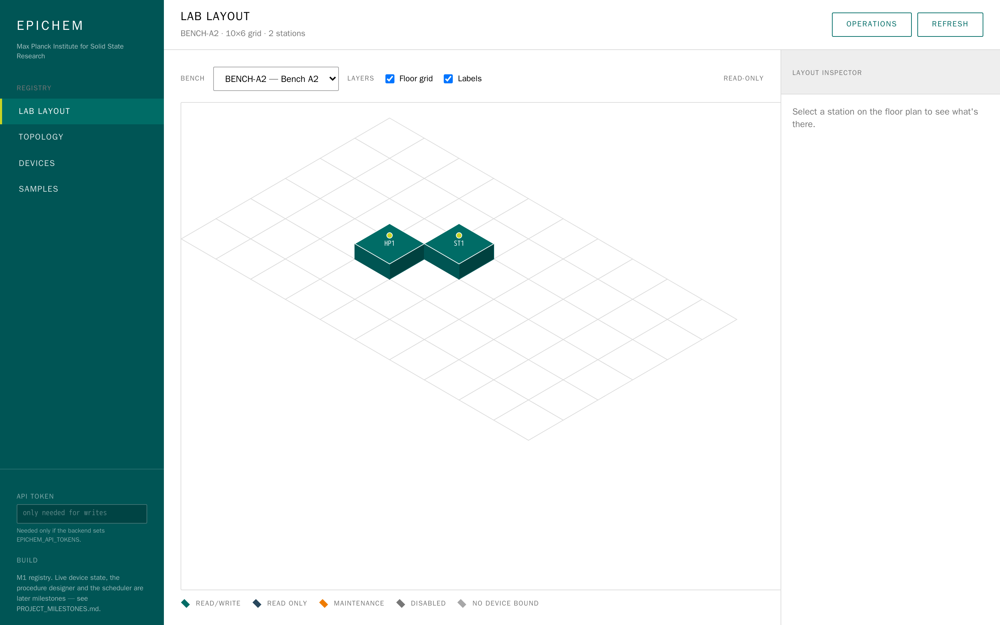

# EPIChem

Lab orchestration control plane for MPI-FKF. This repo is the **registry** — the topology,
device and capability-class model (plan §5/§6) plus a minimal sample model (ADR 0005) — and a
**web console** over it. The database is the versioned source of truth (ADR 0004); YAML is
import/export interchange, not desired state.



*The console has four screens — lab layout (above), topology, devices and samples — which
completes M1. It does not yet run Bluesky or talk to hardware; see
[`PROJECT_MILESTONES.md`](PROJECT_MILESTONES.md) for what's next. The screenshot is generated on
every pipeline run against the real stack (`.gitlab-ci.yml` → `verify:stack`).*

## Run it

```bash
docker compose up
```

That's the whole thing — open **<http://localhost:5173>**. You get Postgres, the schema migrated
to head, the example virtual lab imported, three samples, the API on `:8000` and the console on
`:5173`, with hot reload on both halves. No `.env`, no arguments, nothing beyond Docker.

The services come up in a fixed, enforced order — `db → migrate → seed → api → web` — so a single
`docker compose up` lands on a console with data in it rather than an empty database or an API
serving 500s mid-migration.

```bash
docker compose logs -f api     # follow one service
docker compose down            # stop; the database volume survives
docker compose down -v         # stop and wipe the data, for a clean start
```

## Deploy it

`compose.prod.yaml` runs the same stack from prebuilt registry images — no build step, no bind
mounts, no dev dependencies, and no defaults for its secrets (it refuses to start without a real
database password and API tokens). `.gitlab-ci.yml` lints, tests (including one job against real
Postgres), builds and pushes both images, brings the production stack up and drives the console in
a headless browser to prove it works, then deploys on a manual trigger from a release tag.

**[`docs/HOST_SETUP.md`](docs/HOST_SETUP.md)** is the operations guide — GitLab configuration,
runner registration, the production host, and what still needs a decision from FHI IT.

## More

- **Contributing / dev workflow / project layout:** [`CONTRIBUTING.md`](CONTRIBUTING.md)
- **Full spec:** [`project_plan/EPIChem_Project_Plan.md`](project_plan/EPIChem_Project_Plan.md)
- **Decisions:** [`docs/adr/`](docs/adr/) · **Status:** [`PROJECT_MILESTONES.md`](PROJECT_MILESTONES.md)
</content>
</invoke>
