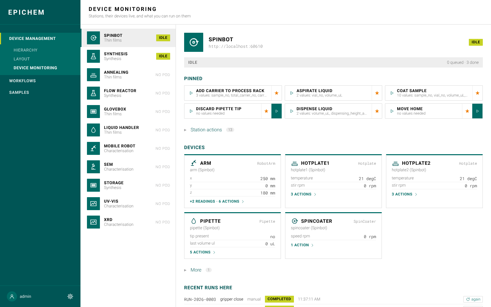
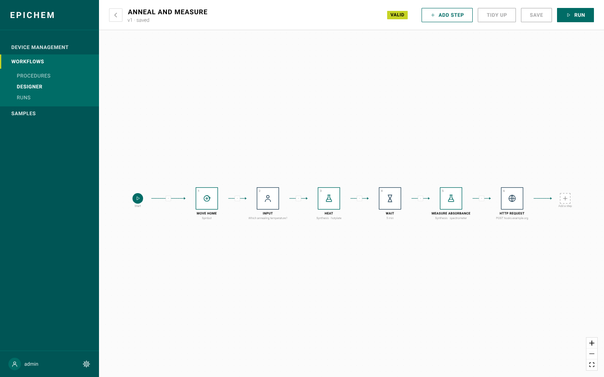

# EPIChem

Lab orchestration control plane for MPI-FKF — a versioned model of sites,
labs, stations and devices, with a web console over it. EPIChem administers
and dispatches; Bluesky/EPICS execute.


## Run it

```bash
docker compose up
```

That brings up Postgres, the API on `:8000`, the console on `:5173`, and three
simulated **Bluesky station pods** (a spin-coating robot, a synthesis
station and a bench, `:60610`–`:60612`), which announce themselves to the API. The database starts **empty** — see
`scripts/README.md` for a local seed script (it also wires stations to the
pods), or just create things through the console.

Open **<http://localhost:5173>**:

- **Device Management** — the hierarchy, the 3D lab layout (at site level
  each lab shows its stations faintly), and Device Monitoring: live
  readings, pinned actions, each device's actions one click away, and runs
  you can repeat with the same values. **New device** lists the pods that
  announced themselves — add one as a station in a click.
- **Workflows** — a searchable procedure library; the designer chains
  station and device actions from any station with Wait / Input / HTTP
  steps — drag them onto the canvas, wire them handle to handle (palette
  and forms come from the pods themselves); run and follow runs live.
- **Samples** — every run registers the sample it produces; lifecycle and
  history per sample.
- **Settings** (the cog at the foot of the nav) — accounts, groups, pod
  set-up; **your account** (beside it) — profile, password, sign out.

| Device Monitoring | Workflow designer |
|---|---|
|  |  |

How the pods work and how to add ophyd devices and plans:
[`docs/BLUESKY.md`](docs/BLUESKY.md).

```bash
docker compose logs -f api     # follow one service
docker compose down            # stop; the database volume survives
docker compose down -v         # stop and wipe the data, for a clean start
```

## More

- **[`docs/`](docs/index.md)** — start here for everything else: current
  roadmap, project history/decisions, API reference, design reference, and
  the full operations guide (`docs/HOST_SETUP.md`).
- **[`CLAUDE.md`](CLAUDE.md)** — working conventions for this repo.
