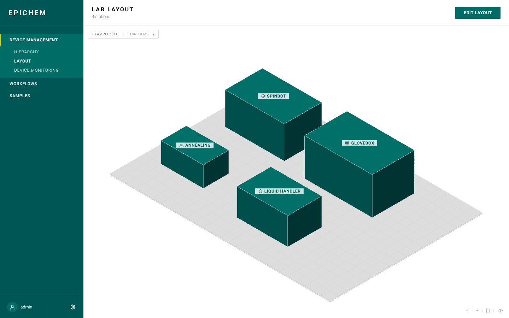

# EPIChem

Lab orchestration control plane for MPI-FKF — a versioned model of sites,
labs, stations and devices, with a web console over it. EPIChem administers
and dispatches; Bluesky/EPICS execute.



## Run it

```bash
docker compose up
```

That brings up Postgres, the API on `:8000`, the console on `:5173`, and two
simulated **Bluesky station pods** (a spin-coating robot and a synthesis
station, `:60610`/`:60611`). The database starts **empty** — see
`scripts/README.md` for a local seed script (it also wires stations to the
pods), or just create things through the console.

Open **<http://localhost:5173>**:

- **Device Management** — the hierarchy, the 3D lab layout, device status.
  Give a station a *Queueserver URL* (e.g. `http://station-spinbot:60610`)
  to make it executable.
- **Workflows** — compose a station's Bluesky plans into a procedure
  (palette and forms come from the pod itself), validate, run, and follow
  runs live.
- **Samples** — every run registers the sample it produces; lifecycle and
  history per sample.

How the pods work and how to add ophyd devices and plans:
[`docs/BLUESKY.md`](docs/BLUESKY.md).

```bash
docker compose logs -f api     # follow one service
docker compose down            # stop; the database volume survives
docker compose down -v         # stop and wipe the data, for a clean start
```

## More

- **[`docs/`](docs/index.md)** — start here for everything else: current
  roadmap, project history/decisions, API reference, design reference, and
  the full operations guide (`docs/HOST_SETUP.md`).
- **[`CLAUDE.md`](CLAUDE.md)** — working conventions for this repo.
