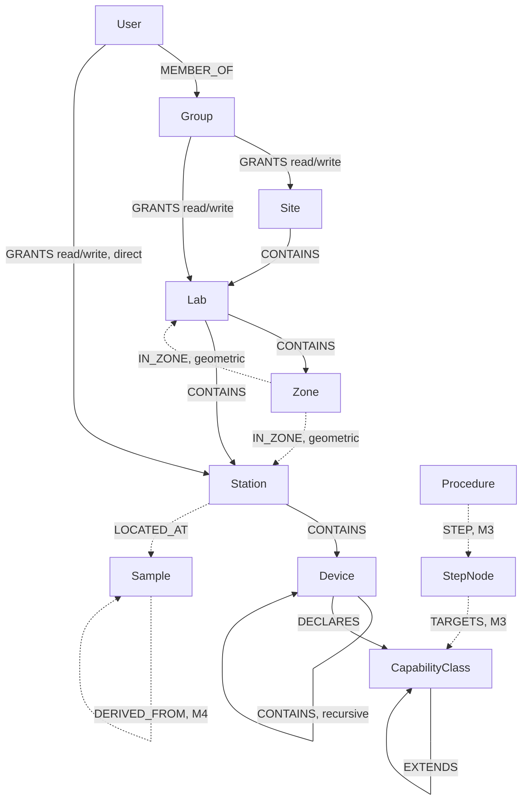

# Graph model, device pods, and multi-user access — a design proposal

**Status: proposal, not decided.** This is the write-up requested for "thinking about rewriting some
of the backend... a GQL implementation... a holistic concept" — a design document only, no code
changes. It packages three draft ADRs, each of which needs an explicit accept/reject/revise before any
implementation starts:

- **[ADR 0017](adr/0017-graph-projection-apache-age.md)** — a graph query layer (Apache AGE, inside
  the existing Postgres) as a *derived, read-optimized projection*. Postgres stays authoritative
  (ADR 0004 untouched).
- **[ADR 0018](adr/0018-per-device-pods-and-cross-station-scheduler.md)** — one IOC container per
  device; the RunEngine/queueserver stays per-Station; cross-plan scheduling is plan §11's Scheduler,
  which *is* EPIChem, not a second execution engine (§3 Non-Goals untouched).
- **[ADR 0019](adr/0019-scope-based-binary-acl.md)** — binary read/write grants per hierarchy scope
  (site/lab/zone/station/device), zero permissions by default, replacing plan §12.1's five global
  roles.

Everything below explains how the three fit together and answers the parts of the original ask that
aren't a single binding decision by themselves: the relationship graph, and when to reach for browser
state vs. Redis vs. the registry vs. the new graph projection.

## 1. The relationship graph

This is what ADR 0017's graph projection actually holds — the same entities the registry already
has (plus two new ones from ADR 0019), drawn as nodes and edges instead of foreign keys. Solid edges
exist today (as FK columns or computed containment); dashed edges are the M3/M4 kinds ADR 0017
deliberately doesn't model until those milestones build the underlying entity.

Reading it: the top half (`Site`→`Lab`→`Zone`/`Station`→`Device`→`CapabilityClass`) is the
containment + capability graph that exists in the schema today, per ADR 0007/0010/0012/0015. The
middle (`Sample`, dashed `DERIVED_FROM`) is §7's lineage DAG — minimal `Sample` rows exist today
(ADR 0005), the DAG doesn't. `Procedure`/`StepNode` (dashed) is §9/§10.4 — not built at all yet (M3).
The bottom (`User`/`Group`/permission edges) is entirely new, from ADR 0019.

The reason this is worth a real graph engine rather than just more relational joins: three of the
system's genuinely hard queries are graph-native operations — "everything under this Site I'm allowed
to write to" (a bounded traversal with an early-exit-on-first-grant rule), "every device with
capability X reachable from Sample Y's current location" (once lineage exists), and "does this
Procedure's StepNode graph contain a cycle or an orphan" (§9.3 tier 3 validation, already specified in
the plan). None of these are natural single-table SQL; all three are a few lines of Cypher/GQL.

## 2. Where does each piece of state live?

This is the "when to use the graph database, when only the browser session, when Redis" question,
answered as one framework rather than three separate ADRs, because it's really one decision repeated
per kind of data — and it already has a precedent to extend rather than invent from nothing: ADR 0006
already reasoned through exactly this tradeoff for Redis, and the frontend README already reasoned
through it for client state (`useAsync`'s "no cross-screen cache to keep coherent",
`useStickyState`'s in-memory-only staged drafts). The table below is that same reasoning applied to
the graph projection and the new ACL.

| Tier | What lives there | Why there and not elsewhere |
|---|---|---|
| **Browser (React state / `useStickyState`)** | Layout-editor drafts (ADR 0014), navigation/breadcrumb position, which panel is open, form-in-progress values | Single-user, single-tab, doesn't need to survive a reload as *committed* data (it's explicitly *not yet committed* — that's the point of staging), and nothing else needs to see it before Save. Never put anything here that a second user or a second tab needs visibility into — see the concurrency gap in §3 below. |
| **`localStorage`** | The bearer token today; the OIDC access/refresh token once ADR 0019 lands | Survives a reload, never sent anywhere but this browser, never shared between users by construction. |
| **Redis** | Live device/queueserver state (§8.2 MQTT-fed), WebSocket fan-out for `/stream` (§8.1), rate-limiting — all per ADR 0006, arriving with M2's device plane, not before. A resolved-ACL cache (ADR 0019's "walk up to nearest grant" result) is a plausible *future* addition here, but only once it's measurably slow — adding it pre-emptively repeats exactly the mistake ADR 0006 already declined to make for the read endpoints. | Ephemeral, fast-moving, disposable, never the only copy of anything. Postgres (or the graph projection) can always regenerate it. |
| **Postgres relational tables** | Every `RegistryEntity` (Site...Sample...`PermissionGrant`), the full-snapshot `Revision` log | System of record. Every write goes through `registry.py`, unconditionally, regardless of which other tier also gets updated. |
| **Postgres + AGE graph projection** | The same entities, as nodes/edges — read-only, derived, rebuildable from `Revision` | Answers relationship-shaped reads (traversal, permission resolution, lineage, DAG validation) that are awkward as repeated relational joins. Never authoritative; never the only copy. |

The one-line version: **if losing it would lose data, it's Postgres. If it's true right now but stops
mattering in seconds, it's Redis. If it's one person's in-progress edit, it's the browser. If it's a
*derived* answer to "how does X relate to Y," it's the graph projection.**

## 3. A gap this surfaced: optimistic concurrency

Plan §8.1 already promises `ETag`/`If-Match` optimistic concurrency on writes; it isn't implemented —
`PUT` today is an unconditional full replace. That's fine while there's effectively one editor at a
time (today's shared-token model has no real notion of "someone else"). It stops being fine the moment
ADR 0019 lets two different principals both hold `write` on the same Lab: two browser tabs (or two
people) can each stage a layout draft (ADR 0014) against the same base state and the second Save
silently overwrites the first's changes with no warning.

Not resolved by any of the three ADRs above — flagged here as the concrete follow-up once ACL lands:
add a version/`etag` column (the existing `Revision.revision_number` is already exactly that counter),
require `If-Match` on `PUT`/`DELETE`, return `409` on mismatch. This was already binding in §8.1; ACL
just makes it load-bearing instead of theoretical.

## 4. What still needs a decision before any of this is implemented

- **ADR 0017**: Apache AGE (in-Postgres) vs. a standalone graph database — the ADR recommends AGE;
  confirm or push back.
- **ADR 0018**: device-pod granularity for hardware that must share one IOC process (multi-channel
  controllers) — one pod per physical unit, or one pod per logical device with shared-IOC devices
  grouped explicitly in the descriptor? The ADR leaves room for either; pick a default.
- **ADR 0019**: whether the binary read/write model needs a third `operate` level now or can wait —
  the ADR defaults to "wait," meaning **read** is sufficient to run a published procedure. Confirm
  that's actually the intended behavior for "most people... run a workflow and not really change
  anything," since it means a read-only viewer of a Lab can also *execute* work in it.
- **Sequencing**: none of the three ADRs blocks the others, but ADR 0019 (ACL) is the one with the
  least existing precedent to build on (no identity system exists at all today) and the most
  prerequisite work (OIDC integration, a real login flow) — it's likely the longest pole if accepted.

## 5. What this proposal deliberately does not change

- §3 Non-Goals — untouched. No execution engine, no device-driver DSL, no ELN, no raw-data store.
- ADR 0004 — untouched. Postgres remains the sole source of truth; the graph projection is derived,
  never authoritative.
- §11 Scheduler's mechanism (resource reservation, wait-for-graph deadlock avoidance, duration
  learning, priority) — untouched. ADR 0018 confirms *where* it lives, not *how* it works.
- §6.3 Capability classes — untouched. It's already the device-abstraction contract asked for; ADR
  0018 leans on it rather than replacing it.
